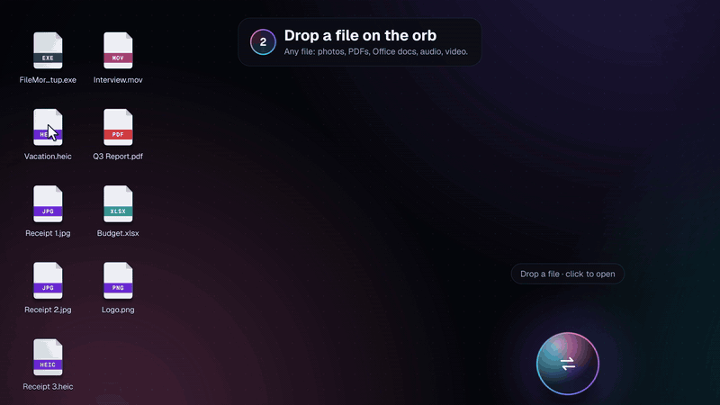
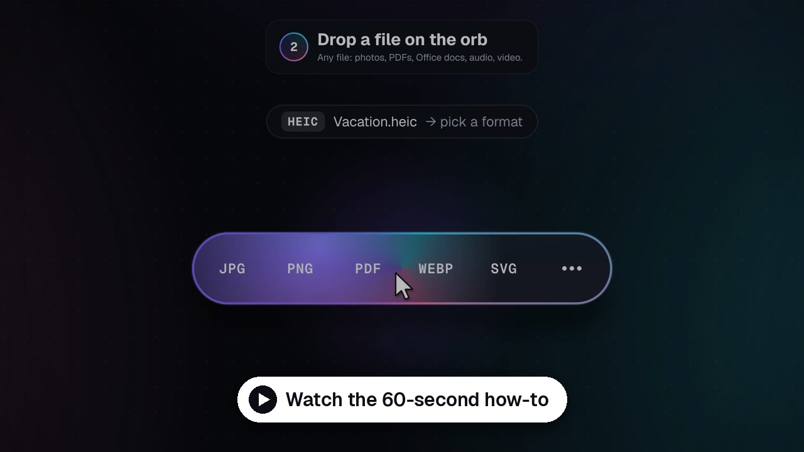
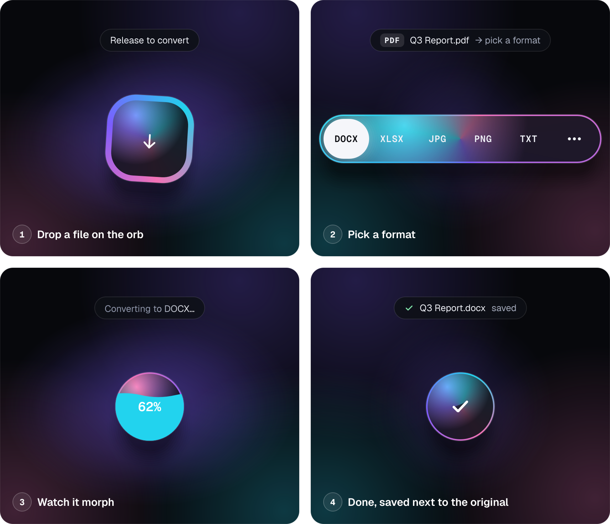
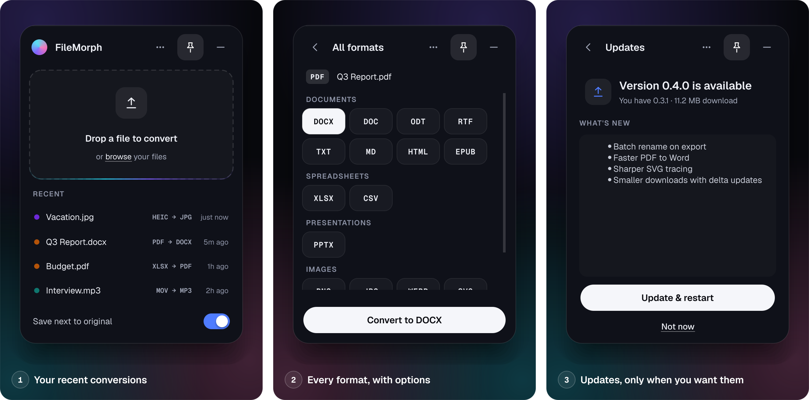

<div align="center">


# FileMorph

**Drop a file. Pick a format. Done.**

A tiny floating orb for your Windows desktop that converts documents, PDFs, spreadsheets,
slides, images, audio and video — **completely offline**. Your files never leave your PC.

[](https://github.com/JuicedSystems/FileMorph/releases/latest)
[](https://github.com/JuicedSystems/FileMorph/releases)
[](#install)
[](https://github.com/JuicedSystems/FileMorph/actions/workflows/build-windows.yml)

### [⬇&nbsp; Download FileMorph for Windows](https://github.com/JuicedSystems/FileMorph/releases/latest/download/FileMorph-win-Setup.exe)

<sub>Free · 42 formats in, 38 out · No account, no uploads, no ads</sub>

<br>



<br><br>

<a href="docs/media/FileMorph-how-to.mp4">
  
</a>

<sub>60-second walkthrough · install, convert, batch to PDF, right-click, updates</sub>

</div>

---

## Why FileMorph

<table>
<tr>
<td width="50%" valign="top">

**🔒 Private by design**<br>
Every conversion runs on your PC. Nothing is uploaded, there's no account and no tracking.
It even works with Wi-Fi off.

</td>
<td width="50%" valign="top">

**⚡ Three seconds, start to finish**<br>
Drop a file on the orb, click a format, done. The five formats you most likely want are
offered first; every other option is one click away.

</td>
</tr>
<tr>
<td valign="top">

**📄 Conversions that actually hold up**<br>
PDF tables become real Excel numbers, PDFs become editable Word documents, photos become
true vector SVGs, iPhone HEIC photos just work.

</td>
<td valign="top">

**🗂️ Batches and folders**<br>
Drop a stack of files (or a whole folder) and convert them together — or combine a mix of
PDFs, Word files, spreadsheets and photos into **one PDF**.

</td>
</tr>
<tr>
<td valign="top">

**🖱️ Built into Explorer**<br>
Right-click any file → **Convert with FileMorph**, or use *Send to*. Select several files and
they open as one batch.

</td>
<td valign="top">

**🔄 Updates only when you want them**<br>
FileMorph never updates behind your back. Click *Check for updates*, read what's new, and
install with one click.

</td>
</tr>
</table>

## How it works

<div align="center">

</div>

The orb lives in a corner of your desktop. Drag a file onto it and it opens into a row of
formats. Pick one and it fills with liquid as it converts, then checks off — the new file is
saved **next to the original**, never overwriting anything (`Report (1).docx` if the name is taken).

Changed your mind? **Click the orb or press Esc** while it's converting to cancel.

<div align="center">

</div>

Click the orb to open the panel: your recent conversions (click one to show it in its folder),
**All formats** with options like quality, resolution, page size and SVG detail, and **Updates**.

## What it converts

| Family | Formats | Highlights |
|---|---|---|
| **PDF** | → DOCX, XLSX, CSV, PPTX, TXT, HTML, PNG, JPG, WebP, TIFF, SVG (+ ODT, RTF, EPUB, MD) | Tables extracted to Excel with numbers kept as numbers · editable Word layout · one image per page · multi-page TIFF |
| **Documents** | DOCX, DOC\*, ODT, RTF, TXT, MD, HTML, EPUB ↔ each other, → PDF, → images | Built-in PDF engine works **without Office**; uses Word or LibreOffice when installed for exact layout |
| **Spreadsheets** | XLSX, XLS\*, ODS, CSV, TSV, JSON ↔ each other, → PDF, HTML | Every sheet kept · ZIP codes and IDs stay intact · wide tables print landscape |
| **Presentations** | PPTX, PPT\*, ODP\* ↔ each other, → PDF\*, → PNG/JPG per slide\*, → TXT | |
| **Images** | PNG, JPG, WebP, AVIF, GIF, TIFF, BMP, ICO, SVG, HEIC (in) | Photo → **true vector SVG** (3 detail levels) · animated GIF/WebP kept · multi-size ICO |
| **Audio** | MP3, WAV, M4A/AAC, FLAC, OGG, Opus · WMA, AIFF (in) | |
| **Video** | MP4, MOV, MKV, WebM, AVI · WMV (in) | → GIF (palette-optimised) · → audio track |

<sub>\* Needs Microsoft Office **or** the free [LibreOffice](https://www.libreoffice.org/download/) installed. FileMorph finds either one automatically and tells you when a file needs it.</sub>

FileMorph plans multi-step routes on its own (`.doc → PDF → JPG`, `HEIC → SVG`) and hides
conversions that make no sense, so every format you're offered is one that works.

## Install

1. **[Download `FileMorph-win-Setup.exe`](https://github.com/JuicedSystems/FileMorph/releases/latest/download/FileMorph-win-Setup.exe)** (about 250 MB — every conversion engine is built in, so nothing else is needed).
2. Run it. FileMorph installs for your user account in a few seconds — **no admin rights needed** — and the orb appears.
3. Drop a file on it.

> [!NOTE]
> FileMorph isn't code-signed yet, so Windows may show **"Windows protected your PC"**.
> Click **More info → Run anyway**. This goes away once releases are signed.

**Requirements:** Windows 10 or 11, 64-bit. Microsoft Office or LibreOffice only for `.doc`, `.xls`, `.ppt` and `.odp` files.
**Uninstall:** Settings → Apps → Installed apps → FileMorph → Uninstall. The right-click menu entries are removed too.

## Tips

| | |
|---|---|
| **Right-click a file** | **Convert with FileMorph** (on Windows 11, under *Show more options*) or **Send to → FileMorph** |
| **Convert many files** | Drop several files or a whole folder. Only formats every file can become are offered. |
| **Make one PDF** | Drop a mix of files → ••• → PDF → turn on **Combine into one PDF** |
| **Cancel** | Click the orb or press **Esc** while it's converting |
| **Keyboard** | In the format row: **← →** to move, **Enter** to convert, **Esc** to close |
| **Choose where files go** | Panel → turn off *Save next to original* → pick a folder |
| **Move or restyle the orb** | Drag it anywhere · right-click it for colorways (Prism, Citrus, Frost), *Keep on top* and *Quit* |
| **Hide it** | Click the tray icon to show or hide the orb |

## Privacy

FileMorph converts everything locally with engines bundled inside the app. It doesn't upload
files, collect analytics or phone home. The only time it goes online is when **you** click
*Check for updates*, which reads this repository's public release list on GitHub. Documents
can't make it download web images or pull in other files from your PC either.

## Updates

Open the panel → **⋯ → Check for updates** (or right-click the orb). If there's a new version
you'll see what's new and the download size; nothing is installed until you click
**Update & restart**. FileMorph swaps in the new version, relaunches and shows *"Updated to x.y.z"*.
Updates are usually small, because only what changed is downloaded.

See [CHANGELOG.md](CHANGELOG.md) for every release.

## FAQ

<details>
<summary><b>Where did my converted file go?</b></summary>

Next to the original file, unless you picked a folder in the panel. The orb's message says
*"saved to &lt;folder&gt;"* whenever it's somewhere else — for example, if the original folder is
read-only, FileMorph saves to **Downloads\FileMorph** instead of failing.
Click the orb after a conversion to open the file, or click it in *Recent* to show it in its folder.
</details>

<details>
<summary><b>It says a file needs Microsoft Office or LibreOffice.</b></summary>

Old binary formats (`.doc`, `.xls`, `.ppt`) and OpenDocument slides (`.odp`) need one of them to
read. Install the free [LibreOffice](https://www.libreoffice.org/download/), then restart FileMorph
(right-click the orb → *Quit FileMorph*, then open it again). Modern formats (`.docx`, `.xlsx`, `.pptx`, PDF) don't need either.
</details>

<details>
<summary><b>A password-protected file won't convert.</b></summary>

That's expected: FileMorph never asks for or stores passwords. Remove the password in the app
that made the file, then convert it.
</details>

<details>
<summary><b>"Check for updates" shows an error.</b></summary>

Make sure you're online and try again. The full error is saved in
`%LOCALAPPDATA%\FileMorph\logs\updates.log` — include it if you open an issue.
Copies run from source (not installed with Setup.exe) can't update themselves.
</details>

<details>
<summary><b>Something went wrong — how do I report it?</b></summary>

[Open an issue](https://github.com/JuicedSystems/FileMorph/issues) with the file type you
converted, the format you picked and the message FileMorph showed. Crash details are in
`%LOCALAPPDATA%\FileMorph\logs`.
</details>

## For developers

<details>
<summary><b>Run from source</b></summary>

Python 3.12 or 3.13 recommended.

```bash
pip install -r requirements.txt
python -m filemorph                 # the floating orb
python -m filemorph --classic       # the original single-window UI
```
</details>

<details>
<summary><b>Tests</b></summary>

```bash
python tests/make_samples.py tests/_samples
python tests/run_matrix.py tests/_samples tests/_out --jobs 4   # every sample → every offered format, outputs validated
python tests/node_screens.py tests/_samples _shots              # drives the real UI end to end and screenshots each state
python tests/update_flow.py _updates                            # every update screen against a simulated release feed
python -m filemorph --selftest selftest.json                    # what CI runs against the packaged .exe
```
</details>

<details>
<summary><b>Build an installer and release</b></summary>

FileMorph is packaged with PyInstaller and installed/updated with [Velopack](https://docs.velopack.io).

**Local build** (Windows, needs the [.NET 8 SDK](https://dotnet.microsoft.com/download) for Velopack's `vpk`):

```powershell
powershell -ExecutionPolicy Bypass -File packaging\build.ps1           # → Releases\FileMorph-win-Setup.exe
powershell -ExecutionPolicy Bypass -File packaging\build.ps1 -Publish  # also uploads a GitHub Release (needs $env:GITHUB_TOKEN)
```

**Shipping a new version** (CI does the rest):

1. Bump `__version__` in `filemorph/__init__.py`.
2. Add a `## <version>` section to `CHANGELOG.md` — it's the *What's new* text users see. CI refuses to release without it.
3. Commit, then `git tag vX.Y.Z` and `git push origin vX.Y.Z`.
4. [GitHub Actions](.github/workflows/build-windows.yml) runs the full test matrix, builds the app, self-tests the packaged `.exe`, and publishes a release with `FileMorph-win-Setup.exe` plus the update packages installed copies download.

`UPDATE_URL` in `filemorph/__init__.py` must point at a **public** repo — installed copies read its releases without a token.
</details>

<details>
<summary><b>Project layout</b></summary>

```
filemorph/
  app.py               entry point · single instance · Explorer hand-off · --selftest
  core/
    formats.py         every format, extension + magic-byte detection
    registry.py        conversion graph and route planning
    engine.py          runs a route in a temp folder, publishes results safely, merge-to-PDF
    proc.py            runs bundled tools: no console windows, cancel, timeouts, cleanup
    updater.py         user-initiated updates (Velopack)
    shell.py           right-click menu, Send to, Open with
    converters/        images · tracing · pdf · documents · sheets · media · office
  ui/node/             the orb (node.py), panel (panel.py), controller.py, motion.py (springs)
  ui/                  conversion worker, classic window
packaging/             PyInstaller spec, build.ps1, release-notes / icon / version-info generators
tests/                 sample generator, conversion matrix, UI and update-flow drivers
marketing/             how-to video renderer and README image renderer
docs/media/            images and video used on this page
```
</details>

## Built with

[PySide6](https://doc.qt.io/qtforpython-6/) ·
[PyMuPDF](https://pymupdf.readthedocs.io/) ·
[pdf2docx](https://github.com/ArtifexSoftware/pdf2docx) ·
[pdfplumber](https://github.com/jsvine/pdfplumber) ·
[Pandoc](https://pandoc.org/) ·
[pandas](https://pandas.pydata.org/) + [openpyxl](https://openpyxl.readthedocs.io/) ·
[Pillow](https://python-pillow.org/) + [pillow-heif](https://github.com/bigcat88/pillow_heif) ·
[vtracer](https://github.com/visioncortex/vtracer) ·
[OpenCV](https://opencv.org/) ·
[FFmpeg](https://ffmpeg.org/) ·
[Velopack](https://velopack.io/) ·
[Geist](https://vercel.com/font) font

<sub>Third-party components keep their own licenses — for example PyMuPDF is AGPL-3.0, Pandoc and the bundled FFmpeg build are GPL, PySide6 is LGPL and Geist is SIL OFL.</sub>

<div align="center">
<br>
<sub>Made by <a href="https://github.com/JuicedSystems">Juiced Systems</a></sub>
</div>
